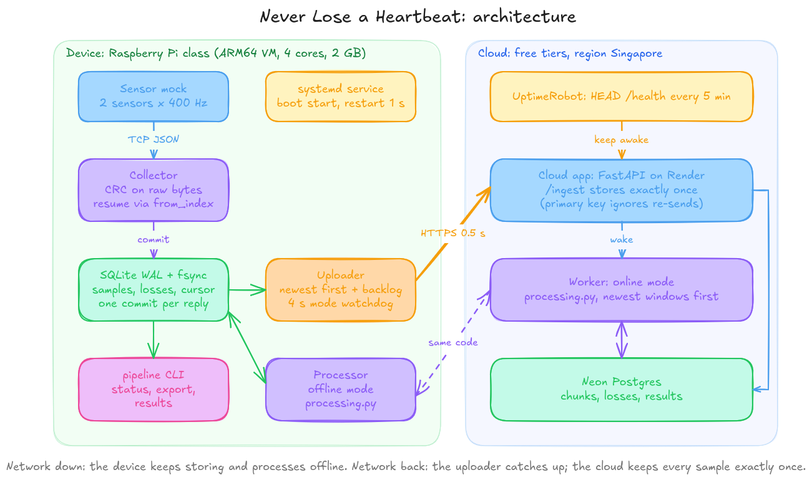

# Never Lose a Heartbeat: device + cloud pipeline

A data pipeline for a bedside device with two sensors (MayaCardio case assessment "Never Lose a Heartbeat").
It saves every sample on the device so that it survives crashes, reboots and power cuts; streams the data to
the cloud and processes each second there within seconds while the network is up; processes on the device
while the network is down; and catches up afterwards, so the cloud ends with every sample exactly once.

- **Device:** Python 3 standard library only (nothing to install), SQLite in WAL mode with fsync on every commit.
- **Cloud:** FastAPI on Render (free web service) + Postgres on Neon (free plan). No paid services.
- **One processing implementation** (`pipeline/processing.py`) is used by both the device and the cloud.



Design note: [docs/DESIGN.md](docs/DESIGN.md) · Test evidence: [docs/EVIDENCE.md](docs/EVIDENCE.md)

## Repository layout

| Path | Purpose |
|---|---|
| `bin/pipeline` | The `pipeline` command |
| `pipeline/protocol.py` | Parses and validates mock replies (CRC-32 over the raw data text) |
| `pipeline/storage.py` | Crash-safe SQLite storage |
| `pipeline/collector.py` | Reads both sensors, stores every sample, records losses |
| `pipeline/processing.py` | Section 3 logic, shared by device and cloud |
| `pipeline/processor.py` | Offline processing on the device |
| `pipeline/uploader.py` | Streaming, catch-up, online/offline switching |
| `pipeline/cli.py` | Command line interface |
| `cloud/app.py` | Cloud service |
| `deploy/` | systemd units for the device |
| `tools/` | Stand-in mock, checkers, test and measurement scripts |

## Install on a fresh board (Raspberry Pi OS / Debian, ARM64)

The systemd units assume the repository is at `/root/maya-pipeline`; adjust the paths in `deploy/*.service` if you use another location.

```bash
sudo -i
apt update && apt install -y git python3 sqlite3 curl
git clone https://github.com/sam1dh/maya-pipeline.git /root/maya-pipeline
cd /root/maya-pipeline
cat > .env <<'EOF'
CLOUD_URL=https://maya-pipeline.onrender.com
CLOUD_TOKEN=<token, provided separately with the submission>
EOF
ln -sf /root/maya-pipeline/bin/pipeline /usr/local/bin/pipeline
```

### The sensor mock

The download link for the official `biosignal-mock` was blank in the assessment document, so development and
testing used `tools/stand_in_mock.py`, written strictly from Section 6 (TCP protocol, CRC-32, 10 s buffer, ramp and
signal modes, fault injection). The pipeline follows the specification, not the stand-in, and connects to
`127.0.0.1:7100` by default.

To run the **official** mock as a service, set its command in `deploy/maya-mock.service`:
```ini
ExecStart=/path/to/biosignal-mock --mode signal --seed 7 --duration 3600 --port 7100
```

### Start

```bash
cp deploy/maya-mock.service deploy/maya-pipeline.service /etc/systemd/system/
systemctl daemon-reload
systemctl enable --now maya-mock maya-pipeline
journalctl -u maya-pipeline -f        # live log: mode switches, progress, losses
```

`maya-pipeline` runs `pipeline run` (collector + processor + uploader). It starts at boot and systemd restarts
it 1 s after any crash or kill.

## Commands

| Command | Output |
|---|---|
| `pipeline status` | One JSON line: mode, current session, samples saved, samples in the cloud, backlog, samples lost |
| `pipeline export --session ID --from device` | One JSON line per sample, then one per loss (spec Section 4 format) |
| `pipeline export --session ID --from cloud` | The same, from the cloud copy |
| `pipeline results --session ID [--from cloud]` | One JSON line per window and mode (Section 3 outputs) |
| `pipeline sessions` | Sessions stored on the device |
| `pipeline run` / `collect` / `process` | The full pipeline, or one part alone for testing |

`--session` defaults to the current session. Sample counts in `status` include both sensors.

## Cloud deployment

1. **Neon:** create a project (region AWS Singapore) and copy the direct (non-pooled) connection string.
2. **Render:** New Web Service from this repository, region Singapore, instance type Free.
   - Build command: `pip install -r cloud/requirements.txt`
   - Start command: `uvicorn cloud.app:app --host 0.0.0.0 --port $PORT`
   - Environment: `DATABASE_URL` (Neon), `CLOUD_TOKEN` (shared secret, same as on the device), `PYTHON_VERSION=3.12.8`
   - Health check path: `/health`
3. **UptimeRobot (free):** HTTP monitor on `https://<service>.onrender.com/health` every 5 minutes, so the free
   Render service never spins down during a long device outage. `/health` does not touch the database, so Neon
   still scales to zero when idle.

## Testing tools

| Tool | Checks |
|---|---|
| `python tools/test_processing.py` | Section 3 logic on 8 min of generated data: 60/90/72 bpm; windowed peak detection identical to a full-session scan; missing-data rules |
| `python tools/phase1_check.py --ramp` | Device database: every index stored once or recorded lost; ramp values unchanged |
| `pipeline export --from device \| python tools/check_export.py` | Export format + ramp values + no silent gaps (stand-in for `check_ground_truth`) |
| `diff <(pipeline export --from device) <(pipeline export --from cloud)` | Cloud copy identical to the device copy |
| `pipeline results --from cloud \| python tools/compare_results.py` | Offline (device) and online (cloud) results identical |
| `pipeline results --from cloud \| python tools/check_latency.py` | Online results within 5 s |
| `python3 tools/resources.py` | CPU, peak memory, disk writes, network use of the service (systemd accounting) |

Failure tests run on the ARM64 VM (`tools/run_vm.sh`) from the host:
```bash
echo "set_link net0 off" | socat - unix-connect:/tmp/qemu-mon     # cut the network
echo "set_link net0 on"  | socat - unix-connect:/tmp/qemu-mon     # restore it
pkill -9 qemu-system-aarch64                                       # power cut
```

## Environment used

Device: QEMU `virt` machine, Cortex-A72 CPU (as in a Raspberry Pi 4), 4 cores, 2 GB RAM, Debian 13 ARM64,
emulated on an x86 laptop (Arch Linux). Cloud: Render free web service + Neon free Postgres, both in Singapore.

## AI tools disclosure

I used Claude (Anthropic) as an assistant throughout: to discuss the design, draft code and documentation, and
plan the tests. I ran every test in this repository myself, on my laptop and on the ARM64 VM, and the results in
`docs/EVIDENCE.md` come from those runs. The design decisions and trade-offs in `docs/DESIGN.md` are ones I can
explain and defend.
